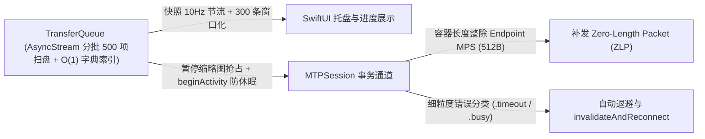

# DroidDock 架构演进与关键排障笔记

> 本文档从工程技术演进与硬核排障视角，提炼整理本机研发过程中的核心架构抉择、十万级传输稳定性突破以及跨协议预览优化实践，作为 [AGENTS.md](../AGENTS.md) 、 [DroidDock-Dev-Spec.md](DroidDock-Dev-Spec.md) 与 [READMAP.md](../READMAP.md) 的横向专题补充。

---

## 一、 核心技术路线决策（自研纯 Swift MTP）

- **放弃 OpenMTP Kalam 路线，自研纯 Swift `USBMTP` Package**：
  - Kalam 底层重度依赖 `libusb` / `libmtp`，存在 GPL/LGPL 许可证与开源传染风险，且缺少针对 macOS 27 与 Apple Silicon 的官方原生维护保障。
  - 最终确立基于 Apple 官方 `IOUSBHost` 与 `SystemConfiguration` / `SQLite3` 自研纯 Swift 6 MTP 客户端（`Packages/USBMTP`），遵循 `Swift 6` 严格并发模型，并以 `FileProvider` 协议向上隔离存储访问细节，为后续无线/ADB 模式预留统一抽象层。
- **macOS 设备抢占实测结论**：
  - 针对 OnePlus 13T 真机实测验证了系统 `ptpcamerad` 进程独占抢占与 `O+Connect Service` AOA 劫持行为的防护处理流程，保障应用连接通道稳定。

---

## 二、 40 GB / 15 万文件大批量传输稳定性突破

在实机测试 40 GB / `155,375` 个文件目录上传时暴露出三个典型高并发与 USB 协议边界故障，经过重构后实现了大规模无卡顿稳定传输：

1. **USB 512 字节整数倍对齐缺少 ZLP 死锁（平均每 512 文件必现）**：
   - **根因**：OnePlus 真机 USB 2.0 Bulk-OUT 端点 `wMaxPacketSize = 512`。当 MTP 容器总长度（12 字节头 + Payload）恰好是 `512` 整数倍（如 500 B 或 65,524 B 文件）时，Android 侧 `MtpFfsHandle::receiveFile` 会一直挂起等待 Zero-Length Packet（ZLP）结束信号；同时旧实现将 10 秒 I/O 超时错误映射为 `.disconnected`，引发连接被清空、整批 15 万项一次性标记失败。
   - **解决**：`IOUSBHostTransport` / `MTPSession` 在端点 MPS 边界主动补发 ZLP；超时放宽至 30s/60s 并精细拆分 `.timeout` / `.busy` 状态，失效句柄通过 `invalidateAndReconnect` 强制重建。
2. **入队扫描与 UI 状态 $O(N^2)$ 假死**：
   - **解决**：`TransferQueue` 改为后台 `AsyncStream` 每批 500 项流式扫盘并即时启动首个任务；将线性查找替换为 `taskIndexByID` 字典与扫描游标，维护增量字节计数及 `ensuredDirectories` 目录缓存（消除每文件反复 `ensureRemoteDirectory` + `session.list` 的 60 万+ 次冗余往返）；UI 快照 10 Hz 节流并在超 400 项时窗口化渲染，整批结束后统一刷新一次目录列表；传输期通过 `ProcessInfo.processInfo.beginActivity` 阻止 App Nap 休眠并暂停后台缩略图拉取。

---

## 三、 高清预览、缩略图管线与无锁防失步

1. **事务锁取消与半截响应防污染（`MTPSession`）**：
   - 修复 `withTransactionLock` 取消唤醒后未接力下一等待者的隐患；在 `downloadObject` 对 `<= 8 MB` 事务取消时先静默排空当前数据流与末尾 12 字节 Response 容器再抛出 `CancellationError`，防止错位响应污染后续缩略图与原图命令。
2. **原图双击高清化与 EXIF 方向校正**：
   - 进入大图预览即优先抢占设备带宽（`setPreviewPrioritized`），支持 `6144 px` 后台预解码、`ImageIO` EXIF 方向 5--8 横竖屏纠正及失败显式重试，绝不静默停留在模糊缩略图。
   - 相册网格改用 LIFO 栈优先服务当前可视区照片；对无原生 `GetThumb` 的图像采用 `GetPartialObject` 仅拉取前 128 KB 提取内嵌 EXIF 缩略图。

---

## 四、 双模无线、测试隔离与零依赖自动升级

- **扫码快传（`QuickDropWebServer`）生命周期与流式下载**：修复 `NWListener.newConnectionHandler` 未强引用处理器导致连接闭环被提前释放的 Bug（引入 `activeHandlers` 注册表）；支持文件夹经 `/usr/bin/ditto` 流式 ZIP 打包下载、媒体缩略图缓存及 HTTP `Range` 视频分段拖拽，并为每个连接隔离独立串行队列。
- **测试宿主 USB 安全隔离（`DroidDockApp`）**：在应用 `.task` 启动入口检测 `XCTestConfigurationFilePath == nil`，运行 `xcodebuild test` 期间完全屏蔽真机 USB Backend 启动，避免自动化单测抢占运行中应用的真机连接。
- **GitHub Releases 零依赖自更新（`AppUpdateService`）**：采用系统 `URLSession` + `CryptoKit.SHA256` 校验 + `hdiutil attach` + `codesign --verify --deep --strict` 严格验签 + 老版本备份回滚，并在活跃传输期显式拦截替换重启，全部实现与校验详见 [READMAP.md](../READMAP.md) 。
